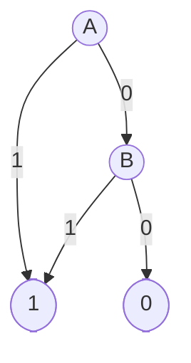
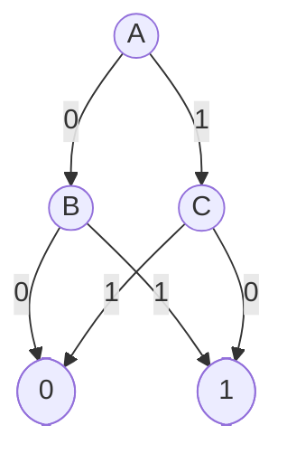

The following is a sheet of formal system excersises and their solutions. It is a mix of problems taken from old exams and practice sheets from the [KIT](https://www.kit.edu/english/) *"[Formale Systeme](https://formal.kastel.kit.edu/teaching/FormSysWS2627/)"* lecture.

## Exercises with Unconfirmed Solution

This section contains only problems without official solutions, solution where checked using AI.

### Exercise 1

We consider equivalence chains of the form

$$\
\varphi_n := P_1 \leftrightarrow P_2 \leftrightarrow \cdots \leftrightarrow P_n.\
$$

**(a)** No parentheses have been written. Which property is the reason for this? How can this property be demonstrated?

**(b)** Given an equivalence chain over literals (rather than atoms) with an even number of negations, the negations can be removed, yielding an equivalent formula. Why?

**(c)** How many clauses does the CNF (Conjunctive Normal Form) of \\(\varphi_n\\) have, depending on \\(n\\)?

**(d)** What does the reduced Shannon graph for \\(\varphi_n\\) look like?

**(e)** Let \\(g_n : \\{W,F\\}^n \rightarrow \\{W,F\\}\\) be defined by

\\[ g_n(v_1,\ldots,v_n) = W \quad \text{iff} \quad \left|\\{i \mid v_i = F\\}\right| \equiv 0 \pmod 2. \\]

Show that the Boolean function \\(f\_{\varphi_n}\\) induced by \\(\varphi_n\\) satisfies

\\[ f\_{\varphi_n} = g_n. \\]

a

- **Atom:** An atomic formula that cannot be split further i.e. a propositional variable. *Examples: $P$, $Q$, $R$ (or $M(x,y)$ in predicate logic)*
- **Literal:** An atom or the negation of an atom, so exactly two forms exist per atom. *Examples: $P$, $\neg P$, $Q$, $\neg Q$*
- **Klausel (clause):** A disjunction (OR) of literals, true as soon as at least one literal is true. *Examples: $P \vee \neg Q \vee R$, $\neg P \vee Q$, $P$ alone, empty clause $\square$ (always false)*
- **KNF (conjunctive normal form):** A conjunction (AND) of clauses, built entirely with $\vee$ inside brackets and $\wedge$ outside.  *Examples: $(P \vee \neg Q) \wedge (\neg P \vee R)$, $(P \vee Q) \wedge (\neg P \wedge \neg Q)$, $(P \vee \neg P) \wedge Q$*
- **DNF (disjunctive normal form):** The mirror image of KNF, a disjunction (OR) of conjunctions (AND) of literals, called terms.  *Examples: $(P \wedge \neg Q) \vee (\neg P \wedge R)$, $(P \wedge Q) \vee \neg R$, $(P \wedge \neg P) \vee Q$*





The reason is that the equivalence operator \\(\leftrightarrow\\) is **associative**.

This means that the placement of parentheses does not affect the truth value of the formula:

\\[ (A \leftrightarrow B) \leftrightarrow C \equiv A \leftrightarrow (B \leftrightarrow C). \\]

**How do we prove associativity?**

We can show it using a truth table:

| \\(A\\) | \\(B\\) | \\(C\\) | \\((A \leftrightarrow B)\leftrightarrow C\\) | \\(A\leftrightarrow(B\leftrightarrow C)\\) |
| ------- | ------- | ------- | -------------------------------------------- | ------------------------------------------ |
| W       | W       | W       | W                                            | W                                          |
| W       | W       | F       | F                                            | F                                          |
| W       | F       | W       | F                                            | F                                          |
| W       | F       | F       | W                                            | W                                          |
| F       | W       | W       | F                                            | F                                          |
| F       | W       | F       | W                                            | W                                          |
| F       | F       | W       | W                                            | W                                          |
| F       | F       | F       | F                                            | F                                          |

Both expressions have identical truth values in every case. Therefore,

\\[ (A \leftrightarrow B) \leftrightarrow C \equiv A \leftrightarrow (B \leftrightarrow C). \\]

By repeatedly applying associativity, we can omit parentheses in an arbitrary equivalence chain.

**Alternative proof using XOR:**

The equivalence operator can be expressed using exclusive OR:

\\[ A \leftrightarrow B \equiv \neg(A \oplus B). \\]

Since XOR is associative, equivalence is also associative:

\\[ (A \leftrightarrow B)\leftrightarrow C \equiv A\leftrightarrow(B\leftrightarrow C). \\]





The key property is that **two negations cancel each other out**:

\\[ \neg(\neg P) \equiv P. \\]

Consider an equivalence chain over literals. Each literal is either an atom \\(P_i\\) or its negation \\(\neg P_i\\).

The equivalence operator is insensitive to an even number of negations. In particular:

\\[ (\neg A) \leftrightarrow (\neg B) \equiv A \leftrightarrow B. \\]

This follows directly from the definition of equivalence: two propositions are equivalent if they have the same truth value. Negating both propositions preserves whether their truth values agree.

Therefore, whenever an equivalence chain contains an even number of negations, they can be removed in pairs without changing the formula's truth value.

More formally, since equivalence is associative, we can write the chain as:

\\[ L_1 \leftrightarrow L_2 \leftrightarrow \cdots \leftrightarrow L_n. \\]

Negating an even number of literals does not change the resulting equivalence. Thus, the chain is equivalent to the same chain with all negations removed.





### **(c) Number of clauses in the CNF**

To obtain the CNF, we construct one clause for every assignment that makes \\(\varphi_n\\) false. Each clause is false for exactly one assignment and therefore excludes that assignment.

From the definition of the equivalence chain, \\(\varphi_n\\) is true if and only if the number of false variables is even. Consequently, it is false if the number of false variables is odd.

There are \\(2^n\\) possible assignments in total. Exactly half of them have an odd number of false variables. This can be seen by flipping the truth value of the first variable: every assignment with even parity is paired with exactly one assignment with odd parity.

Thus, the number of assignments with odd parity is

\\[ \frac{2^n}{2}=2^{n-1}. \\]

Since we need one clause for each assignment that makes the formula false, the resulting canonical CNF contains

\\[ \boxed{2^{n-1}\text{ clauses}.} \\]





The Shannon graph (or Binary Decision Diagram, BDD) represents the Boolean function by testing variables one after another.

For each variable \\(P_i\\), we have two outgoing edges:

- \\(W\\): the variable is true.
- \\(F\\): the variable is false.

Recall that \\(\varphi_n\\) is true if and only if the number of false variables is even.

The key observation is that we only need to remember the **parity** of the number of false variables encountered so far.

Therefore, we need only two different non-terminal nodes at each level:

- \\(E\\): an even number of false variables so far.
- \\(O\\): an odd number of false variables so far.

The transitions are:

| Current node | \\(P_i=W\\) | \\(P_i=F\\) |
| ------------ | ----------- | ----------- |
| \\(E\\)      | \\(E\\)     | \\(O\\)     |
| \\(O\\)      | \\(O\\)     | \\(E\\)     |

Initially, we start in state \\(E\\), since zero false variables is even.

After processing all \\(n\\) variables:

- \\(E\\) leads to terminal \\(1\\) (true).
- \\(O\\) leads to terminal \\(0\\) (false).

**Structure of the reduced Shannon graph:**

Parity-state representation

**Start: E (even)**

For each variable \\(P_i\\):

**E**

W → E

F → O

**O**

W → O

F → E

After \\(P_n\\)

**1 (true)**

Even parity

**0 (false)**

Odd parity

The graph therefore has two parity states per variable level (with the initial and terminal nodes), rather than an exponentially growing number of nodes.

**Important:** In the actual reduced ordered Shannon graph, nodes are merged whenever their remaining Boolean functions are identical. The two parity states remain distinct, because their outputs are opposite for every remaining assignment.





We prove the statement by induction over \\(n\\).

**Base case (**\\(n=1\\)**):**

For one variable, we have

\\[ \varphi_1=P_1. \\]

Thus,

\\[ f\_{\varphi_1}(v_1)=W \iff v_1=W. \\]

This is exactly the definition of \\(g_1\\), since zero false variables is even. Therefore,

\\[ f\_{\varphi_1}=g_1. \\]

**Inductive step:**

Assume that the statement holds for \\(n-1\\), meaning

\\[ f\_{\varphi\_{n-1}}(v_1,\ldots,v\_{n-1})=W \\]

if and only if the number of false variables among \\(v_1,\ldots,v\_{n-1}\\) is even.

We know that

\\[ \varphi_n=\varphi\_{n-1}\leftrightarrow P_n. \\]

A biconditional is true exactly when both operands have the same truth value.

We distinguish two cases:

1\. **If&#x20;**\\(v_n=W\\)**:**

The value of \\(\varphi_n\\) is the same as the value of \\(\varphi\_{n-1}\\). The number of false variables does not change, so its parity remains the same.

2\. **If&#x20;**\\(v_n=F\\)**:**

The value of \\(\varphi_n\\) is the opposite of the value of \\(\varphi\_{n-1}\\). The number of false variables increases by one, so its parity changes.

In both cases, \\(\varphi_n\\) is true exactly when the total number of false variables among \\(v_1,\ldots,v_n\\) is even.

Therefore,

\\[ f\_{\varphi_n}(v_1,\ldots,v_n)=W \iff \left|\\{i\mid v_i=F\\}\right|\equiv 0\pmod 2. \\]

This is precisely the definition of \\(g_n\\). Hence,

\\[ \boxed{f\_{\varphi_n}=g_n.} \\]

Thus, the statement holds for all \\(n\in\mathbb{N}\\) by mathematical induction.

📚Practise another induction proofTap to set up



### Exercise 2

Give the reduced Shannon graph (OBDD) that is equivalent to the Shannon formula

\\[ sh(P_3,P_2,P_1) \\]

and respects the ordering

\\[ P_1 < P_2 < P_3 \\]

of the propositional variables.



The Shannon expansion of a Boolean function with respect to variable \\(P\\) is

\\[ sh(P,f_1,f_0)=(P\land f_1)\lor(\neg P\land f_0). \\]

Therefore,

\\[ sh(P_3,P_2,P_1) = (P_3\land P_2)\lor(\neg P_3\land P_1). \\]

We want to construct the reduced OBDD respecting the variable ordering

\\[ P_1\<P_2\<P_3. \\]

### **Step 1: Start with&#x20;**\\(P_1\\)

Apply Shannon expansion with respect to \\(P_1\\).

- If \\(P_1=W\\), the function becomes \\(P_3\\).
- If \\(P_1=F\\), the function becomes \\(P_3\land P_2\\).

Thus:

\\[ f= \begin{cases} P_3 & P_1=W,\\\ P_2\land P_3 & P_1=F. \end{cases} \\]

### **Step 2: Expand with respect to&#x20;**\\(P_2\\)

For the \\(P_1=W\\) branch, the function is simply \\(P_3\\), so we can skip \\(P_2\\).

For the \\(P_1=F\\) branch:

- If \\(P_2=W\\), the function becomes \\(P_3\\).
- If \\(P_2=F\\), the function becomes \\(F\\).

### **Step 3: Expand with respect to&#x20;**\\(P_3\\)

The remaining functions are:

- \\(P_3\\): true if \\(P_3=W\\), false if \\(P_3=F\\).
- \\(F\\): always false.

### **Step 4: Reduced OBDD**





### Exercise 3

Give the reduced Shannon graphs (OBDDs) for the following two propositional logic (AL) formulas, respecting the variable ordering \(A < B < C\):

- \(\varphi := A \lor B\)
- \(\psi := \neg(A \land C)\)

Construct a Shannon graph for the conjunction \(\varphi \land \psi\) from these, and derive the CNF from the resulting graph.



We need to construct the reduced OBDDs for

\\[ \varphi = A \lor B \\]

and

\\[ \psi = \neg(A \land C) \\]

under the variable ordering \\(A < B < C\\), then construct the Shannon graph for \\(\varphi \land \psi\\) and derive a CNF from it.

## **a) OBDD for&#x20;**\\(\varphi = A \lor B\\)

We follow the variable ordering \\(A < B < C\\).

- If \\(A = 1\\), then \\(\varphi = 1\\), regardless of \\(B\\).
- If \\(A = 0\\), then \\(\varphi = B\\).

Thus, the root node is \\(A\\). Its 1-edge leads directly to the terminal \\(1\\), and its 0-edge leads to node \\(B\\).

- If \\(B = 1\\), then \\(\varphi = 1\\).
- If \\(B = 0\\), then \\(\varphi = 0\\).

The reduced OBDD for \\(\varphi\\) is therefore:

## **b) OBDD for&#x20;**\\(\psi = \neg(A \land C)\\)

Using De Morgan's law:

\\[ \psi = \neg A \lor \neg C \\]

We consider the variable ordering \\(A < B < C\\). Since \\(B\\) does not occur in the formula, it is omitted from the graph.

- If \\(A = 0\\), then \\(\psi = 1\\), regardless of \\(C\\).
- If \\(A = 1\\), then \\(\psi = \neg C\\).

Thus, the root is \\(A\\). Its 0-edge leads directly to the terminal \\(1\\), while its 1-edge leads to node \\(C\\).

- If \\(C = 0\\), then \\(\psi = 1\\).
- If \\(C = 1\\), then \\(\psi = 0\\).

The reduced OBDD for \\(\psi\\) is:

## **c) Shannon graph for&#x20;**\\(\varphi \land \psi\\)

We combine the two formulas:

\\[ \begin{aligned} \varphi \land \psi &= (A \lor B) \land \neg(A \land C)\\\ &= (A \lor B) \land (\neg A \lor \neg C) \end{aligned} \\]

We examine the two branches of the root node \\(A\\).

- Case \\(A=0\\): The formula simplifies to \\(B\\), since \\(\varphi = B\\) and \\(\psi = 1\\).
- Case \\(A=1\\): The formula simplifies to \\(\neg C\\), since \\(\varphi = 1\\) and \\(\psi = \neg C\\).

Therefore, the combined Shannon graph is:

## **d) Deriving the CNF from the graph**

We derive the CNF by considering all paths from the root to the terminal \\(0\\). Each such path corresponds to a clause that excludes the assignment represented by that path.

Path 1: \\(A=0, B=0\\)

This path reaches terminal \\(0\\). The corresponding clause is:

\\[ A \lor B \\]

Path 2: \\(A=1, C=1\\)

This path also reaches terminal \\(0\\). The corresponding clause is:

\\[ \neg A \lor \neg C \\]

Combining both clauses yields the CNF:

\\[ \boxed{ (A \lor B) \land (\neg A \lor \neg C) } \\]

This is the CNF of \\(\varphi \land \psi\\).


